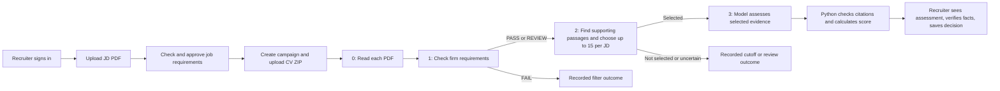

# CV Screening Engine: A Plain-Language Architecture Guide

This guide explains the *reason* for each part of the system and follows one fictional application from sign-in to a recruiter's decision. The worked values below are **illustrations**, not the output of an actual run. Code links point to the implementation.

## 1. The whole system in one picture

A recruiter has a job description (JD) and many CVs. The useful question is not “Is this person generally good?” It is “What does this particular CV show for this particular approved job, what is still uncertain, and what should a person inspect?” If one CV is compared with four jobs, the system creates four separate candidate/job assessments.



Think of the stages as four different jobs:

| Stage | Simple question | Why it happens here |
|---|---|---|
| 0. Read | Can we get reliable words from the PDF? | A blurry scan is a document problem, not a poor candidate. |
| 1. Check | Does the CV meet explicit minimum rules? | Clear rules can be checked cheaply and repeatably. |
| 2. Find | Where does the CV show relevant *work*? Is it among the strongest supported matches? | A tool name in a skills list is weaker than an account of using it. This stage limits expensive model calls. |
| 3. Judge | How strong is the supported work? | Interpreting depth and fit needs more judgment; the model sees selected source material. |

An ordinary keyword-only ATS can find “Java” while missing “never used Java,” a course exercise, or actual delivery depth. Sending every raw CV to a large language model (LLM) would repeat long documents, cost more, and give the model too much room to invent quotations or apply requirements inconsistently. The funnel gives narrow, auditable tasks to the cheapest appropriate mechanism. Stage 1 still uses keywords where exact technical identity matters; Stage 2 also uses meaning and source context. See [rules_engine.py](../app/stage1_rules/rules_engine.py), [coverage.py](../app/stage2_retrieval/coverage.py), and [llm_client.py](../app/stage3_evaluation/llm_client.py).

## 2. One realistic JD, before any CV is uploaded

Suppose a recruiter uploads this **fictional PDF** for a Senior Java Backend Engineer:

> Build and operate Java/Spring Boot services for payments. Design REST APIs and PostgreSQL data models. Write automated tests and investigate production incidents. Minimum four years of professional experience and a completed Bachelor's degree in Computer Science or a related computing field. Kafka is helpful, not required. Work authorization is not a screening requirement for this campaign.

### First, the recruiter signs in: password, JWT and cookies

On the [login page](../frontend/src/app/features/login.ts), the recruiter enters an email/username and password. [The API](../app/api/auth.py) looks up the account and checks the password against its stored **Argon2 hash**. A hash is a one-way result computed from the password: the database keeps the hash, not a readable copy of the password. Argon2 deliberately makes each password guess costly. After repeated failed attempts, the account is temporarily locked. This is why a password check happens on the server instead of in browser code.

After a valid password, [the authentication code](../app/core/auth.py) creates a short-lived **JWT** (JSON Web Token). Think of it as a signed pass containing the recruiter's user ID and an expiry time. Its contents are readable by someone who has the token; the signature prevents them from changing those contents undetected. The server signs it with a secret key; on later requests it checks the signature, expiry, intended issuer/audience and the account's current token version. A changed token fails signature validation. Logout increments the account's token version, making its older tokens unusable. The server also checks that the account still exists and is active. Thus this implementation **does consult the database on authenticated requests**; it is not a completely database-free JWT system.

The API puts the JWT in an **HTTP-only cookie** named `cv_access`. A cookie is a small browser-stored value automatically sent with requests to this site. *HTTP-only* means browser JavaScript cannot read the JWT, reducing the chance that injected page script can steal it. In production, the cookie also has the `Secure` flag so the browser sends it over HTTPS, and `SameSite=Lax` limits when cross-site requests carry it. The [Angular session code](../frontend/src/app/core/session.ts) calls `/auth/me` to learn who is signed in and protects recruiter pages; it keeps user display state, not the JWT itself.

There is a second cookie, `cv_csrf`, for **CSRF protection**. CSRF means a different website tricks a logged-in browser into submitting a change using its automatically attached login cookie. This second value is readable by the application's JavaScript; Angular copies it into the `X-CSRF-Token` header on requests that change data. The API compares the cookie, header and a hash tied to the JWT. Another site cannot normally read this site's cookie and supply the matching header. The login/logout routes also check request origin. The CSRF value is **not** the login credential.

**JWT versus “simple cookie login” is not an either/or choice.** This system uses a *JWT inside a cookie*. A common alternative is an opaque random session ID in a cookie, with all session details stored server-side. Both approaches can use HTTP-only, Secure and SameSite cookies; both need attention to CSRF when cookies authenticate changes.

| Choice | How it would work here | Main tradeoff |
|---|---|---|
| Current signed JWT in an HTTP-only cookie | The browser sends a signed, expiring credential; API code verifies it, then checks the user/version in PostgreSQL. | The signed claims provide a portable identity contract across API workers and can also be accepted as a bearer token by other clients. The signing key and token checks must be managed carefully. |
| Opaque server-side session cookie | The browser sends a random ID; the API looks up its session record each time. | Easier individual session revocation, but a shared session store and its lifecycle become another dependency. |
| JWT in browser `localStorage` | JavaScript reads the token and sends it in an authorization header. | Avoids automatic cookie sending, but a page script can also read and steal the token. This UI deliberately keeps the login token out of JavaScript. |

The code shows the current design and its tradeoffs; it does not document a measured comparison that proves JWT is universally better than server-side sessions. In non-production development, a local identity fallback can bypass normal login; the above describes the production browser flow.

### Next, the recruiter uploads and approves the JD

1. On the [campaign creation page](../frontend/src/app/features/create.ts), the recruiter uploads the JD **as a PDF**. A PDF preserves the recruiter's original wording and layout. [The JD intake API](../app/api/jds.py) reads its text and asks the configured LLM provider to propose structured fields: title, minimum experience, degree, skills and responsibilities. The provider saves typing, but it can misread wording, so its proposal is a **draft** and cannot yet drive screening.
2. The recruiter checks the draft's **hard requirements** (must be met) separately from **preferences** (helpful but optional). A *relevance target* is one specific responsibility to find in a CV, such as “designed REST APIs,” together with its exact **source quote** from the JD. Source quotes make the rule traceable to wording the recruiter actually uploaded. The API checks those quotes against extracted JD text before approval, limiting invented requirements.
3. Approval saves an **immutable version**: a past approved profile is not silently edited. The recruiter then creates a **campaign**, meaning one screening batch using one or more approved JDs. The campaign stores a **snapshot**, a frozen copy of the requirements and policy used for that run. If the recruiter later revises the JD, old results can still be understood under the rules that produced them. See [jd_intake.py](../app/jd_intake.py), [jds.py](../app/api/jds.py), and [campaigns.py](../app/api/campaigns.py).

A simplified view of the **approved** data might look like this. This is explanatory pseudodata, not a request body to copy into the API:

```yaml
title: Senior Java Backend Engineer
hard_filter_rules:
  min_years_experience: 4
  degree_requirement:
    level: BACHELOR
    fields: [Computer Science, Software Engineering]
  require_work_authorization: false
must_have_skills:
  - { canonical: Java, aliases: [], substitutes: [] }
  - { canonical: Spring Boot, aliases: [], substitutes: [] }
  - { canonical: PostgreSQL, aliases: [Postgres], substitutes: [] }
nice_to_have_skills:
  - { canonical: Kafka, aliases: [], substitutes: [] }
relevance_targets:
  - "Built Java/Spring Boot services for payments"
  - "Designed REST APIs and PostgreSQL data models"
  - "Wrote automated tests and investigated production incidents"
```

The real profile also has **query categories** (Skills, Experience, Projects, Education: where to search), **target IDs** (stable names for requirements), **importance** (relative weight) and **evidence term groups** (which concepts must appear in a supporting passage). These help Stage 2 look for the right work and keep Kafka as a preference. An **alias** is the same skill written differently (`Postgres`); a **substitute** is a different technology the recruiter explicitly accepts instead. Treating every related tool as an alias would quietly weaken a requirement. See [relevance.py](../app/stage1_rules/relevance.py) and [jd_profiler.py](../app/stage1_rules/jd_profiler.py).

## 3. One fictional CV through the entire flow

The recruiter uploads a **ZIP**, a compressed bundle containing `Asha_Rai.pdf` and other CV PDFs. The current browser campaign path accepts a ZIP because one request can start a whole campaign. [ZIP intake](../app/campaigns/intake.py) checks file type, size, number of files and member names; these limits prevent huge or unsafe archives from consuming the host. It records accepted and rejected files separately. For each accepted CV, it creates a **candidate/job pair** for every approved JD: one CV can have different results for different roles. The PDF is extracted once and its text is reused across those pairs. See [the archive endpoint](../app/api/campaigns.py).

Upload returns a **campaign ID** and progress state instead of keeping the browser request open until all CVs finish. [Celery workers](../app/workers/tasks.py) perform long-running extraction, retrieval and model work in the background; **Redis** carries work messages, while **PostgreSQL** stores the lasting progress and results. A work message is a request to do a job, not the final truth about whether it finished. Workers can retry after interruption; saved IDs and state checks prevent a retry from creating a second candidate assessment. This is more reliable for a large batch than doing everything inside the upload request. The UI reads progress from the API while the jobs run.

Assume `Asha_Rai.pdf` visibly says:

```text
Asha Rai — Backend Engineer
Experience
Backend Engineer, RiverPay | January 2021 – August 2026
Built Java and Spring Boot payment services serving merchant transactions.
Designed REST APIs backed by PostgreSQL and added automated integration tests.
Investigated production incidents and documented recovery steps.
Skills: Java, Spring Boot, PostgreSQL, Docker
Education: B.Sc. Computer Science, completed 2020
```

**Important:** these are fictional claims in a CV. The engine can read and cite them; it cannot confirm that Asha actually held the job or performed the work.

### Step 0 — Read the PDF

[Stage 0](../app/stage0_extraction/pipeline.py) first checks that the file really is a supported PDF and respects its size/page limits. **PyMuPDF** reads text already stored inside a PDF and reports where each block sits on a page. A *block* is a small region of text; [the parser](../app/stage0_extraction/parser.py) orders blocks so two-column CVs do not become a jumbled sentence. Reading embedded text is faster and usually more accurate than treating every page as an image.

If the PDF page is a scan, the page is **rendered** into pixels (like taking a picture of it) and **Tesseract OCR** guesses the words from that picture. OCR means *optical character recognition*. It is a fallback because recognition can mistake letters or dates; the pipeline checks whether the result is readable. Page, pixel and time limits stop unusually large or difficult scans from monopolizing a worker. A cloud OCR service could provide another recognition engine, but local Tesseract avoids a separate upload/provider dependency for every scan.

For Asha's normal text PDF, the conceptual output is:

```yaml
stage0_status: SUCCEEDED
ocr_used: false
text: "Experience\nBackend Engineer, RiverPay | January 2021 – August 2026\nBuilt Java ..."
source_locations: [{ page: 1, block: 3 }, { page: 1, block: 4 }]
```

The stored **source locations** link words back to their page/block, so later evidence can be inspected in context. If extraction fails, the pair receives `EXTRACTION_FAILED`; it is **not** assigned a suitability score of zero. The processing PDF is **encrypted at rest**: database bytes are unreadable without the server's encryption key. That temporary processing copy is cleared after use. A separate encrypted original may remain for authorized recruiter viewing. The field name `redacted_text` is historical: the current default keeps full extracted text, including personal data, so access to it still matters. See [CampaignCVModel](../app/models/database.py) and [recruiter document routes](../app/api/recruiter.py).

### Step 1 — Apply firm requirements

[The rules engine](../app/stage1_rules/rules_engine.py) compares the extracted CV with the **approved** JD. A *deterministic rule* means the same facts and same policy (including the same date for “present” jobs) lead to the same check. This is useful for firm requirements: the model should not improvise whether four years means four years or whether Kafka was mandatory.

| Approved rule | What Asha's extracted CV shows | Example check |
|---|---|---|
| At least four years' experience | January 2021–August 2026 is above four years when evaluated after August 2026; it is still a CV claim. | `REVIEW / EXPERIENCE_UNVERIFIED` |
| Completed computing Bachelor's degree | “B.Sc. Computer Science, completed 2020.” | `PASS / EDUCATION_MET` |
| Java, Spring Boot, PostgreSQL | All three identities appear positively. | `PASS` for each required skill |
| Work authorization | Recruiter disabled this filter for this JD. | `PASS / AUTHORIZATION_NOT_REQUIRED` |

The aggregate Stage 1 result is **`REVIEW`**, because the years are sufficient *as written* but have not been independently verified. This is **provenance**: the system records whether a fact came from CV text, a recruiter check, or nowhere reliable. `REVIEW` continues to Stage 2, preserving a promising but unconfirmed applicant. A definite shortfall, such as two clear years against a four-year minimum, would instead be `FAIL` even if the two-year claim was unverified. Unknown or ambiguous dates remain reviewable.

[The experience parser](../app/stage1_rules/experience.py) reads month-dated jobs and calculates the *union* of employment periods: overlapping jobs count only once. For example, January 2020–January 2022 plus January 2021–January 2023 is about three elapsed years, not four. Year-only or conflicting statements are less precise. “2021–present” also needs an **as-of date**, meaning the date on which the calculation is made. This rule-based approach is easier to audit than asking a model to guess tenure from prose.

The system does **not** have one production switch called `upload_only` versus `strict`. Those labels appear in the synthetic benchmark's comparison of CV-only facts and supplied verified facts. Here, the CV is initially an unverified source. The recruiter may later record verified facts separately.

### Step 2 — Find supporting work and decide whether to use an LLM slot

First, [the chunker](../app/stage2_retrieval/chunker.py) divides the extracted CV into **chunks**, short passages grouped under Skills, Experience, Projects or Education. It keeps a job heading with its bullets where possible, so “designed REST APIs” stays attached to the RiverPay job. This is like placing bookmarks in a long document. Sending isolated words would lose context; searching the whole CV as one block could bury the relevant sentence.

Next, [the evidence extractor](../app/stage2_retrieval/evidence_extractor.py) searches those passages for each approved target:

| JD target | CV passage the system could find | Why it matters |
|---|---|---|
| Java/Spring Boot payment services | “Built Java and Spring Boot payment services serving merchant transactions.” | Shows *applied* work, not just a skills-list mention. |
| REST APIs and PostgreSQL | “Designed REST APIs backed by PostgreSQL and added automated integration tests.” | Connects API and database work in one source sentence. |
| Tests and incidents | Tests and production incident sentences. | Shows two more responsibilities. |
| Kafka preference | No evidence. | May reduce preference coverage; it does not fail the mandatory filter. |

Two search methods work together. **Semantic search** turns the JD target and each chunk into an *embedding*: a list of numbers that places related meanings near one another. For example, it may connect “built payment services” with a differently worded description of payment API work. **Lexical search** checks the actual written technical concepts, protecting distinctions such as Java versus JavaScript. Using only word matching would miss paraphrases; using only embeddings could blur exact technology names. The system combines their ranked lists, then a local **reranker** reads each promising target/passage pair more closely and orders the hits. [PostgreSQL](../app/stage2_retrieval/repository.py) stores the ordinary records and passages; its **pgvector** extension compares embeddings. Keeping these searches in the same database simplifies ownership and source tracking compared with a separate vector service. These search numbers locate evidence; they are **not** hiring scores.

[Coverage rules](../app/stage2_retrieval/coverage.py) ask whether the retrieved sentence actually contains enough reviewed concepts for each JD target. This is **evidence coverage**, not a claim that the candidate is good. Applied responsibility targets require an action in Experience or Projects; a skills list alone cannot prove delivery. The coverage calculation uses Skills 30%, Experience 40%, Projects 15%, Education 15% for applicable requirements. These weights say how much each type of *found evidence* matters to shortlisting. Preferences can provide a small bonus, but cannot qualify a CV alone. This score is an uncalibrated *shortlist ordering signal*, not the final 0–100 fit score.

For this illustration, suppose Asha has sufficient coverage and ranks **4th** after the complete candidate pool is processed. The **gate** is the rule that admits at most **15 pairs per JD** to the more costly Stage 3 model call. She is selected. If she ranked 18th while still eligible, she would get `CUTOFF_EXCLUDED`: no model assessment and no recruiter rejection. If there were no supported applied work, the pair would require relevance review. [The coordinator](../app/campaigns/coordinator.py) waits for the JD's Stage 1/2 pool before freezing the shortlist; otherwise the fastest worker, rather than the best-supported CV, could take a limited slot.

### Step 3 — Interpret the evidence, then verify it in Python

The **LLM** is a language model that can interpret how substantial and relevant a work example seems. It receives the approved JD requirements plus **bounded context**: selected CV text within request-size limits, linked to its source. A *token* is a piece of text counted against the model's input/output budget. [Context preparation](../app/stage3_evaluation/context.py) and [compaction](../app/stage3_evaluation/compact.py) avoid repeating the same physical sentence and give it a short handle such as `E3`. This reduces tokens without replacing a full fact with a vague summary. If source material must be omitted to fit a limit, that omission is recorded for review.

The provider returns **structured output**: four category scores, explanations called *rationales*, potential issue *flags*, a summary and the handles it selected as support. Structured output means the answer must fit expected fields, so Python can validate it. A model is useful for interpreting delivery depth, but less reliable as the owner of exact quotations or policy arithmetic. That is why it selects evidence handles instead of typing the factual quote itself.

A simplified exchange might be:

```text
Trusted source sentence E3: "Built Java and Spring Boot payment services serving merchant transactions."
Model response: skills=88, experience=82, projects=70, education=90; use E3 as support.
Python lookup: E3 belongs to this candidate, request, category and source location.
Stored citation: stable evidence ID + exact source sentence + page/block reference.
```

The short handle only exists within this request; it cannot be reused for another CV. The **stable evidence ID** identifies the source sentence and its origin in the stored assessment. A *citation* is the link from a model claim to that evidence. [Python verification](../app/stage3_evaluation/evidence.py) checks that the selected handle belongs to this candidate, request and category, then attaches the exact original text. This prevents the model from turning it into “Built ... payment services” or accidentally omitting “prototype,” “supervised,” or “never.” Letting the model write its own quote would be simpler to request, but it could introduce a small wording change that reverses the meaning. A valid citation proves those words came from the supplied document; it does **not** prove the CV claim is true or that the interpretation is sound.

[Python scoring](../app/stage3_evaluation/scoring.py) computes the final score using **different weights from Stage 2**:

```text
0.40 × skills 88 + 0.30 × experience 82 + 0.20 × projects 70 + 0.10 × education 90
= 82.80 → Tier 1 (75 or above)
```

Those category values are invented to demonstrate the calculation. The model's actual output can differ. Python applies the fixed weights and thresholds so the model cannot quietly change the scoring rule. `SUCCESS` means Stage 3 passed its evidence policy; Asha's result can still be **provisional** because Stage 1 experience verification is outstanding. A HIGH or CRITICAL *flag* (the model marks a serious question) or an evidence verification problem leads to `REVIEW_REQUIRED` with no final tier. A provider or processing failure leads to `EVALUATION_FAILED` and **no score**. Tier 2 spans 55 to below 75; Tier 3 is below 55. A valid zero score means the assessment ran and scored poorly; a missing score means no valid assessment was produced.

### What is stored and what the recruiter actually sees

| Record | Example content | Why it exists |
|---|---|---|
| `approved_jds` | The checked Java role profile | Makes requirements explicit before screening. |
| `campaigns`, `campaign_jds` | Campaign owner and frozen JD/policy | Keeps each run's rules stable. |
| `campaign_cvs` | Asha's file identity, extraction status/text/locations | Extracts once and retains source context. |
| `campaign_pairs` | Asha **for this Java JD**: Stage 1 `REVIEW`, Stage 2 rank 4, Stage 3 score 82.80/Tier 1, verification needed | Keeps one complete machine outcome per CV/JD pair. |
| `candidate_reviews`, `candidate_review_events` | Human decision, notes, verified facts, actor and history | Separates the recruiter's judgment from the original machine assessment. |

See [database models](../app/models/database.py). A **database table** stores one kind of record; a **candidate/job pair** is the link between one CV and one JD in this campaign. Keeping pair rows means the same CV can receive different outcomes for Java and QA without overwriting either. The `result_snapshot` stores the machine assessment as it was produced. A separate review table stores later human actions.

The [recruiter pool API](../app/api/recruiter.py) reads owner-authorized records from PostgreSQL; the [Angular results page](../frontend/src/app/features/recruiter-results.html) turns them into filters, badges, scores and candidate detail. An **API** is the set of server endpoints the browser asks for data. Angular is the browser UI; its TypeScript code manages screen state and HTTP requests. The browser shows backend statuses and scores; it does not recalculate rules or tiers. A detail request can include source excerpts and document locations. An authorized recruiter can view the retained encrypted original PDF or extracted text when available; a missing PDF copy is shown as unavailable. The older campaign rankings projection returns citation locations but not excerpts.

Suppose the recruiter reviews Asha's CV, confirms 5.6 years of relevant employment with the candidate, and saves `SHORTLIST`, perhaps with a note to ask about Kafka. [The review API](../app/api/recruiter.py) records `verified_facts.experience_years`, decision, reviewer, version and an **audit event**: a dated record of who saved what. The UI's **effective eligibility** display can then show verified experience as passing and clear that question. “Effective” means the display takes later human-verified facts into account. **The original Stage 1 and Stage 3 snapshots remain as they were**, so the system does not pretend it knew the fact earlier.

`SHORTLIST` is a human workflow decision, separate from Stage 2's technical shortlist and from hiring. Other human choices are `UNREVIEWED`, `HOLD`, and `NOT_PROCEEDING` (which requires a reason). The review row has a **version number** that increases with each save. If two recruiters edit the same decision at once, an outdated version receives a conflict and must be refreshed; this avoids silently overwriting someone else's decision. The recruiter can also filter candidates, inspect other-role results, compare candidates and export a pool. See [candidate-detail.ts](../frontend/src/app/shared/candidate-detail.ts) and [recruiter.py](../app/campaigns/recruiter.py).

## 4. Why these technologies are here

| Tool or idea | Plain-language role | Why it fits this job |
|---|---|---|
| Argon2 + signed JWT in an HTTP-only cookie | Checks passwords and carries a short-lived recruiter identity to the API | Passwords stay as slow-to-guess hashes; JavaScript cannot read the login token; the API verifies its signature and account version. A server-side session cookie is a valid alternative with a different storage/revocation tradeoff. |
| Python + FastAPI + Pydantic | Runs the API and validates structured inputs/outputs | One language for PDF, rules, ML and API; validation stops malformed data before decisions. |
| PyMuPDF + Tesseract | Reads native PDF text or scanned page images | Coordinates help retain evidence locations; local OCR handles image-only CVs without a separate cloud OCR call. |
| PostgreSQL + pgvector | Saves campaigns, outcomes, chunks and search vectors | Durable audit records and candidate-scoped search live in one database. |
| SentenceTransformers + local embedding/reranking models | Finds relevant CV passages | Repeated passage search stays local; model calls are reserved for deeper interpretation. |
| Redis + Celery workers | Runs long extraction/search/model jobs in the background | The browser can receive a campaign ID and check progress while work continues; retries and capacity are coordinated. PostgreSQL remains the durable record. |
| Configured LLM provider | Interprets depth and fit for shortlisted candidates | Used only where judgment adds value; Python still owns rules, citations and final arithmetic. |
| Angular + TypeScript | Recruiter workflow and results UI | Typed screens expose machine outcomes, open questions and separate human decisions. |
| SQLAlchemy + Alembic | Database access and schema migrations | Keeps persisted structures explicit and supports versioned upgrades. |
| Docker Compose | Runs API, database, queue and specialized workers together | Makes the service layout reproducible on the target host. |
| Fernet encryption for PDF storage | Scrambles original/temporary PDF bytes in the database | The server can recover a document when authorized; a database copy alone does not expose readable PDF bytes. Derived CV text remains sensitive. |

These are rationales supported by the code's responsibilities, **not** claims that every alternative was benchmarked and rejected.

## 5. The synthetic demo: what it can and cannot prove

The sibling `CV-Benchmark-Dataset-Generator` project created `output_system_demo`: **1,000 CV PDFs**, **15 layout templates**, **four JDs** (Java, .NET, QA and Data), and therefore **4,000 CV/JD pairs**. It varies role fit, dates, degrees, missing/negated skills, overlaps, and image-only scans. Its three anchor CVs, `CV0001`–`CV0003`, contain applied evidence across all four jobs. They should survive each demo's shortlist as a regression control; production has no special ID-based bypass for them.

| File in `output_system_demo` | Read it as |
|---|---|
| `approved_profiles.json` | The intended reviewed JD rules/targets. |
| `ground_truth.json` | Expected row per CV/JD pair: extraction type, Stage 1 results, full-source Stage 2 oracle, and Stage 3 rubric ranges. |
| `demo_summary.json` | Counts, scenario mix and expected shortlist summaries. |
| `validation.json` and `manifest.json` | Generation checks and artifact/source hashes. |
| `cvs.zip` | The uploadable CV PDFs only. |

The generator's Stage 1 expectations run the actual policy code on synthetic facts. Its Stage 2 *oracle* sees every generated source line, so it is a ceiling for what retrieval could find, not proof that embedding search will find it. Stage 3 ranges are expectations, not measured live model outputs or real-world hiring truth. The generator has **11 tests** across its benchmark, scoring and system-demo suites; they cover repeatable profiles/PDFs, scan cases, overlapping tenure, score bounds, scenario expectations, comparison mismatches and checksum refusal. Comparing production results requires exporting **all** pairs, including failures and cutoff cases.

## 6. Small glossary and practical lessons

| Term | Meaning in this system |
|---|---|
| OCR | Reading words from a picture of a page when the PDF's text cannot be used. |
| JWT | A signed, expiring identity token. Here it lives inside an HTTP-only browser cookie; the API verifies it and checks the user account. |
| Cookie / HTTP-only / CSRF | A cookie is automatically sent by the browser. HTTP-only hides the login token from JavaScript. CSRF protection makes changing requests prove they came from this site's UI. |
| Hard filter | An explicit approved minimum, such as four years or a required technology. `FAIL` is a definite rule failure; `REVIEW` preserves uncertainty. |
| Provenance | Where a fact came from: CV text, recruiter verification, or unknown. A CV claim is not automatically verified. |
| Dated work-history union | Add non-overlapping employment time; overlapping jobs do not count twice. Unclear dates stay uncertain. |
| Chunk | A bounded passage with source location, usually grouped around a section or job entry. |
| Embedding | A numeric representation that helps retrieve passages with related meaning. Similarity is not proof of qualification. |
| Retrieval gating | Stage 2's decision about supported relevance and the limited Stage 3 shortlist. |
| Token | A model billing/context unit. It is not the same as a word, character or byte. |
| Prompt compaction | Reuse each source sentence once, use short evidence handles, and remove duplicate formatting while keeping the actual source facts. |
| Citation/evidence ID | A reference from an assessment to a known source passage and location. Python checks the reference and attaches the exact text. |
| Provisional success | Valid Stage 3 evidence and tier with a separate Stage 1 fact still awaiting recruiter verification. |

The measured **61.8% mean input-token reduction** comes from a twelve-case offline before/after report for the current compact prompt. Its old estimated inputs were **7,502–20,045** tokens per CV/JD pair; optimized inputs were **3,352–6,727**. The often remembered **3.8k–7k** range describes successful live v14 *total* usage, not the old baseline. The saving mostly comes from avoiding repeated source sentences, long IDs and model-generated quotes. It does not imply 61.8% lower bills or faster end-to-end campaigns.

The operating rules to remember are simple: preserve uncertain cases for review; keep extraction errors separate from low fit; cite exact source text; treat retrieval scores as search/coverage signals; keep the model's interpretation separate from Python's arithmetic and verification; and keep recruiter decisions separate from both. No stage can establish whether a CV's employment claims are true. A human still owns the hiring decision.
